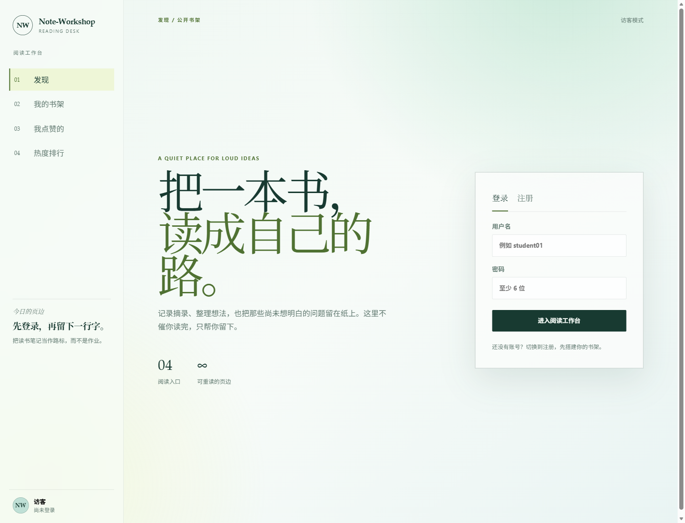
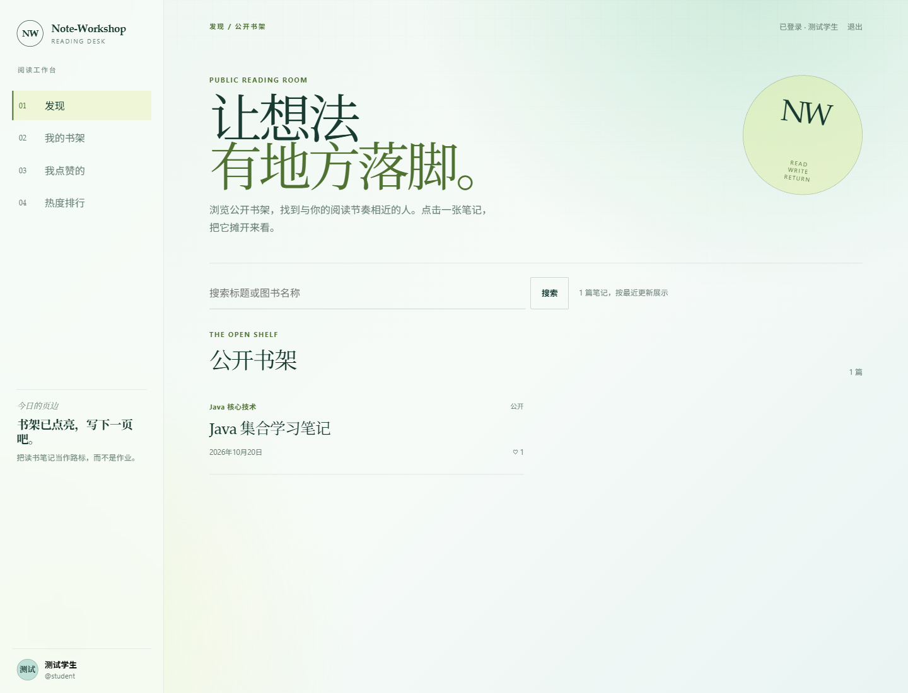
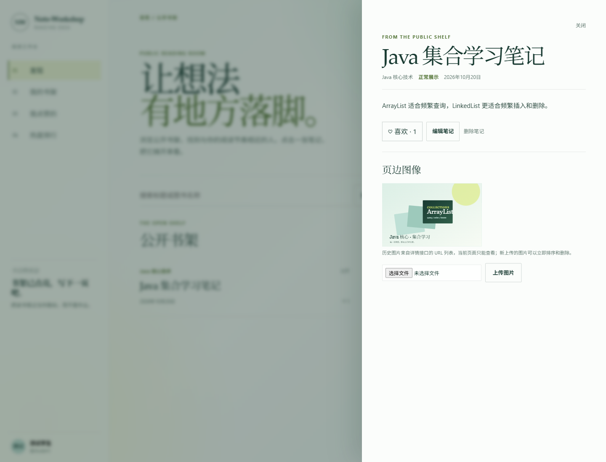
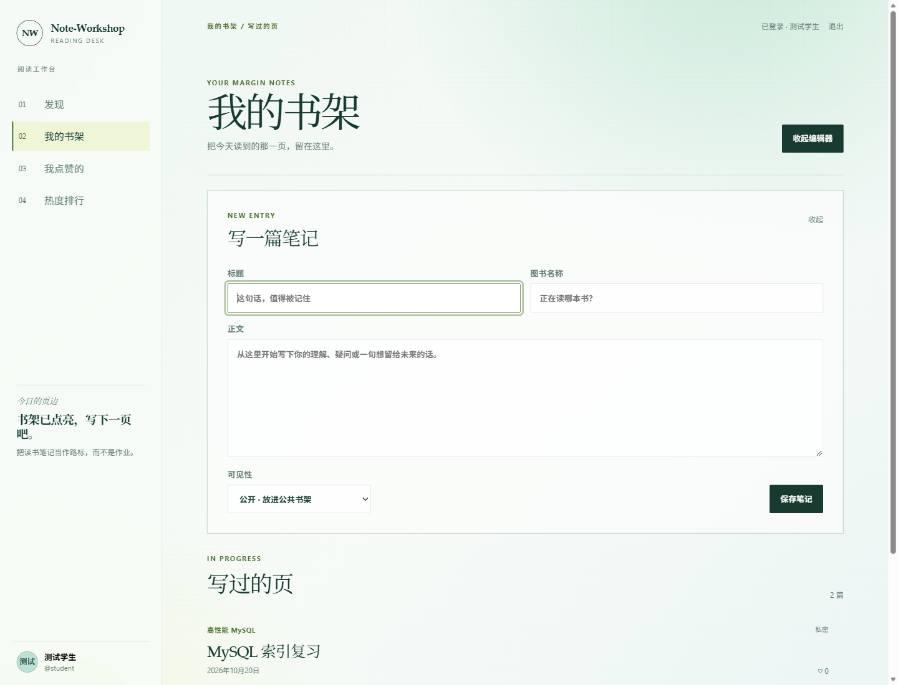
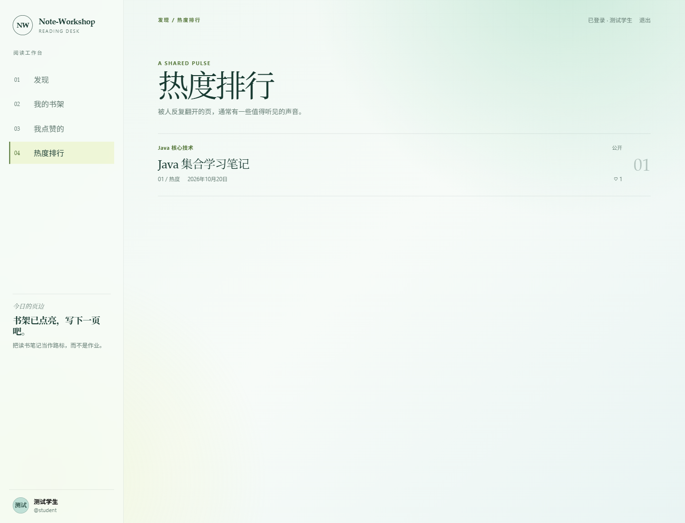
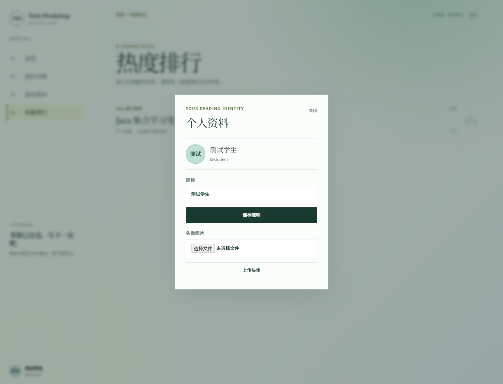
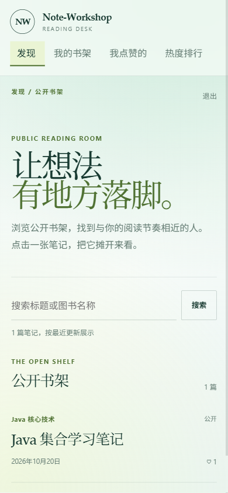

# Note-Workshop 最终演示与答辩指南

## 1. 演示目标

在有限时间内完整示示 Note-Workshop 的核心闭环：

```text
注册/登录
→ 浏览公开笔记
→ 查看详情和图片
→ 点赞
→ 我的书架
→ 创建/编辑笔记
→ 上传图片
→ 我点赞的笔记
→ 热度排行
→ 个人资料
→ 响应式页面
```

## 2. 环境准备

### 必需环境

- JDK 25
- MySQL 8
- 已执行 `docs/sql/schema.sql`
- 已配置数据库和 JWT 环境变量

### PowerShell 启动

```powershell
$env:DB_URL="jdbc:mysql://localhost:3306/note_workshop?useUnicode=true&characterEncoding=utf8&serverTimezone=Asia/Shanghai&allowPublicKeyRetrieval=true&useSSL=false"
$env:DB_USERNAME="<数据库用户名>"
$env:DB_PASSWORD="<数据库密码>"
$env:JWT_SECRET="<至少 32 字节的随机字符串>"
$env:JWT_EXPIRATION_MINUTES="120"
$env:UPLOAD_DIR="uploads"

java -jar target/note-workshop-0.0.1-SNAPSHOT.jar
```

也可以使用：

```powershell
mvn spring-boot:run
```

### 浏览器地址

```text
http://localhost:8080/
```

### 演示账号

```text
用户名：student
密码：123456
```

## 3. 截图清单

### 登录页



讲解重点：

- 同源部署；
- JWT 登录；
- 页面视觉方向；
- 响应式布局。

### 公开书架



讲解重点：

- 公开笔记分页；
- 标题和图书名称搜索；
- 笔记点赞数；
- `likedByMe` 状态。

### 笔记详情



讲解重点：

- 详情接口；
- 多图示示；
- 点赞和取消点赞；
- 作者编辑与删除权限；
- 私有/隐藏笔记权限控制。

### 创建笔记



讲解重点：

- 私有/公开可见性；
- 参数校验；
- 创建后写入 MySQL；
- 图片上传限制。

### 点赞排行



讲解重点：

- 实时点赞数统计；
- 点赞数降序；
- 零点赞笔记也参与排行；
- `LEFT JOIN` 与稳定排序。

### 个人资料



讲解重点：

- JWT 当前用户；
- 昵称修改；
- 头像上传；
- BCrypt 密码哈希与 JWT 分离。

### 移动端



讲解重点：

- 响应式布局；
- 导航切换；
- 移动端无横向溢出；
- 键盘焦点和可访问性。

## 4. 建议现场演示顺序

### 第 1 步：登录

1. 打开首页；
2. 输入 `student / 123456`；
3. 点击“进入阅读工作台”；
4. 示示左侧导航和用户状态。

### 第 2 步：公开书架

1. 示示公开笔记；
2. 在搜索框输入图书关键词；
3. 说明标题和图书名称都会参与匹配；
4. 指出点赞数和当前用户点赞状态。

### 第 3 步：笔记详情

1. 点击“Java 集合学习笔记”；
2. 示示正文和配图；
3. 点击喜欢/取消喜欢；
4. 示示点赞数同步变化；
5. 说明只有作者或管理员可以编辑和删除。

### 第 4 步：创建笔记

1. 进入“我的书架”；
2. 点击“写一篇笔记”；
3. 填写标题、图书名称和正文；
4. 选择公开或私密；
5. 保存后示示分页列表中的新笔记。

### 第 5 步：图片上传

1. 打开自己创建的笔记；
2. 选择一张 jpg/png 图片；
3. 点击“上传图片”；
4. 示示新图片、删除、上移和下移；
5. 说明单张最大 5MB、每条笔记最多 6 张。

### 第 6 步：点赞排行

1. 进入“热度排行”；
2. 示示按点赞数降序排列；
3. 说明零点赞笔记仍然保留；
4. 示示当前用户的 `likedByMe`。

### 第 7 步：用户资料

1. 点击左下角个人资料；
2. 示示昵称和头像；
3. 可选：修改昵称后保存；
4. 说明头像 URL 保存在数据库，文件保存在上传目录。

### 第 8 步：移动端

1. 打开浏览器开发者工具；
2. 切换到手机尺寸；
3. 刷新页面；
4. 示示顶部导航和单列笔记布局。

## 5. 后端知识点讲解顺序

### 分层架构

```text
Controller → Service → Mapper → MySQL
```

- Controller：参数接收、校验、调用 Service；
- Service：权限、事务、业务规则；
- Mapper：数据库 CRUD；
- JWT：认证与用户上下文。

### 数据库设计

- `user`：用户、BCrypt 密码、角色、状态；
- `note`：笔记、可见性、状态；
- `note_image`：多图和排序；
- `note_like`：点赞关系，唯一索引防重复。

### 文件上传

- 校验扩示名、MIME 类型和真实图片内容；
- UUID 文件名防止冲突和路径穿越；
- 单张 5MB；
- 每条笔记最多 6 张；
- 删除事务提交后清理物理文件。

### 点赞与排行

- `note_like(user_id, note_id)` 唯一索引；
- 点赞和取消点赞幂等；
- `likedByMe` 来自当前 JWT 用户；
- 排行使用 `LEFT JOIN`，零赞笔记不丢失；
- 列表批量查询点赞数据，避免 N+1。

### 删除级联

- 删除 `note_image`；
- 删除 `note_like`；
- 删除 `note`；
- 事务提交后删除磁盘图片；
- 文件删除失败只记录日志，不回滚数据库。

## 6. 常见提问与回答

### 为什么密码不存明文？

使用 BCrypt 哈希，登录时通过哈希比对验证密码。

### 为什么使用 JWT？

JWT 可以无状态传递用户身份，后端通过拦截器解析并写入 `UserContext`。

### 为什么点赞使用唯一索引？

同一个用户对同一篇笔记只能有一条点赞记录，数据库唯一索引可以处理并发重复点赞。

### 为什么点赞排行使用 LEFT JOIN？

需要保留零点赞的公开笔记，`INNER JOIN` 会把这些笔记过滤掉。

### 为什么删除图片要放在事务提交后？

数据库事务无法回滚文件系统；先提交数据库再删除文件，避免数据库回滚后文件已经丢失。

### 为什么列表批量查询点赞？

逐篇查询会产生 N+1 SQL；批量查询当前页笔记的点赞记录，再在内存中聚合。

## 7. 演示备用方案

如果现场网络或 MySQL 临时不可用：

1. 打开本文档中的截图；
2. 按截图顺序讲解前端流程；
3. 使用 `docs/api.md` 说明接口；
4. 使用 `docs/postman/note-workshop.postman_collection.json` 示示接口测试设计；
5. 展示 `mvn test` 的 97 个通过用例结果。

## 8. 演示结束语

```text
当前已完成 P0 用户、笔记、图片和点赞模块，
前端可以完整示示主要业务流程，
后端包含参数校验、JWT 鉴权、事务、文件补偿清理和 97 个自动化测试。
后续可扩示管理员审核、关注、评论和 AI 阅读辅助。
```
---

## 9. P1/P2 功能现场演示补充

当前项目已完成 P0、P1、P2，不再只演示基础笔记闭环。建议答辩时按下面的顺序展示。

### 第 1 步：登录与角色

- 使用 `student / 123456` 登录，展示公开书架、作者关注、评论和 AI 功能；
- 使用 `admin / 123456` 登录，展示管理后台入口；
- 说明 JWT 拦截器还会查询数据库状态，因此禁用账号后旧 token 会立即失效。

### 第 2 步：公开笔记审核

1. 普通用户创建一篇公开笔记；
2. 打开“我的笔记”，指出状态为“待审核”；
3. 使用管理员进入“管理后台 → 待审核”；
4. 可以通过或填写驳回意见；
5. 驳回后回到普通用户详情页，展示审核意见；
6. 修改后点击“提交审核”；
7. 管理员通过后，笔记进入公开书架。

可以讲解：

- 公开和私有是可见性；
- 审核状态是内容是否允许公开；
- 只有 `visibility = 1`、`status = 1`、`auditStatus = 1` 的笔记会进入公开列表；
- 私有笔记只有作者自己可见。

### 第 3 步：作者关注与统计

1. 打开“发现作者”；
2. 点击关注；
3. 打开作者主页；
4. 展示粉丝数、关注数和公开笔记数；
5. 取消关注并展示状态变更。

### 第 4 步：评论、回复和级联删除

1. 进入一篇审核通过的公开笔记详情；
2. 发表一级评论；
3. 回复这条评论；
4. 再回复一次形成三级结构；
5. 删除中间评论；
6. 刷新后展示该评论和全部子回复消失；
7. 管理员也可以删除其他用户的违规评论。

可以讲解：

- 父评论和子评论通过 `parent_id` 关联；
- 删除使用逻辑删除 `status = 0`；
- 使用广度优先遍历收集全部子孙节点；
- 整个操作在事务中完成。

### 第 5 步：AI 阅读辅助

1. 作者打开自己的笔记详情；
2. 点击“生成 AI 阅读分析”；
3. 展示摘要、适宜人群、完整性、相关性、深度评分；
4. 点击“丢弃”，说明结果没有写入数据库；
5. 再生成一次并点击“保存结果”；
6. 刷新详情，展示 `aiResult`；
7. 再次生成并保存，说明仍然只有一份结果；
8. 管理员查看 AI 统计，展示总调用、成功和失败次数。

可以讲解：

- AI 结果不直接写入 `note` 主表；
- `note_ai_result` 对 `note_id` 建唯一索引；
- 分析接口只返回结果，保存接口才持久化；
- 每次调用都写 `ai_audit_log`；
- 没有 `AI_API_KEY` 时使用本地可演示分析器，有 key 时切换真实大模型。

### 第 6 步：AI 智能客服

1. 进入“AI 客服”；
2. 新建会话；
3. 询问“公开笔记审核规则”；
4. 继续追问“被驳回怎么办”，展示同一会话上下文；
5. 打开另一个历史会话，展示上下文隔离；
6. 使用第二个账号访问同一会话接口，展示 403 越权保护；
7. 删除会话，说明消息一并删除；
8. 管理员查看 AI 统计。

可以讲解：

- 会话归属唯一用户；
- 每次操作都校验当前用户是否为会话所有者；
- 只携带最近 10 轮消息；
- 用户消息与 AI 回复都持久化；
- system prompt 限定客服回答范围。

### 第 7 步：管理员用户与内容管理

1. 管理员进入用户管理；
2. 禁用测试账号；
3. 使用该账号旧 token 访问 `/api/users/me`，展示 403；
4. 管理员下架违规公开笔记；
5. 展示公开列表中不再出现该内容；
6. 展示 AI 调用统计。

## 10. 答辩讲解顺序建议

1. 项目目标与用户角色；
2. 分层架构；
3. 数据库表和索引；
4. JWT + BCrypt + 账号状态校验；
5. 笔记审核状态机；
6. 多图上传与事务后文件清理；
7. 点赞唯一索引与排行查询；
8. 关注统计；
9. 评论树和级联逻辑删除；
10. AI 结果隔离与手动保存；
11. AI 会话隔离、滑动窗口和审计；
12. 97 个自动化测试与最终演示结果。

## 11. 演示备用方案

如果真实 AI 接口不可用：

- 不配置 `AI_API_KEY`，直接使用本地可演示分析器；
- 说明生产环境可通过 `AI_BASE_URL` 和 `AI_MODEL` 切换 OpenAI 兼容模型；
- 强调 AI 审计、手动保存、结果隔离和越权校验仍然完整。

如果网络或数据库现场异常：

- 保留 README 中的接口图和数据库表结构截图；
- 使用 Postman Collection 说明请求设计；
- 展示 `mvn test` 的 97 个通过用例结果；
- 说明核心数据一致性和事务边界。

## 12. 最终状态说明

```text
P0 基础功能：已完成
P1 进阶功能：已完成
P2 AI 功能：已完成
自动化测试：97 个通过
前端：完整可操作
数据库：初始脚本 + 增量迁移脚本
```